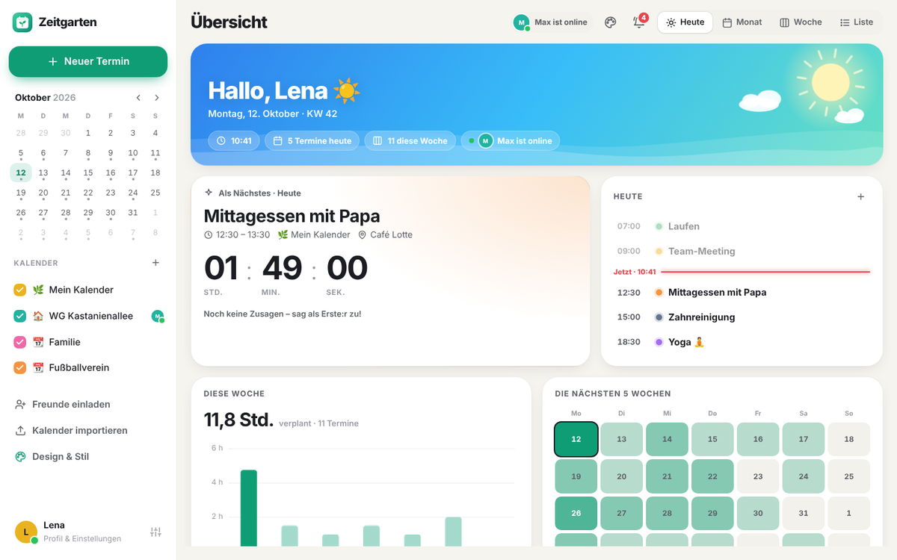
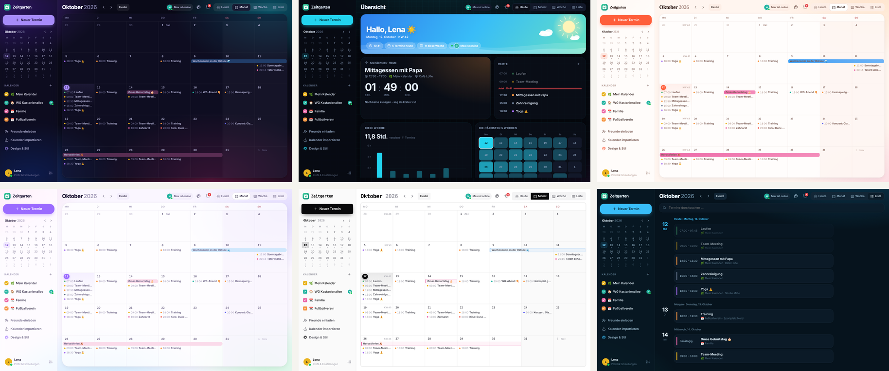
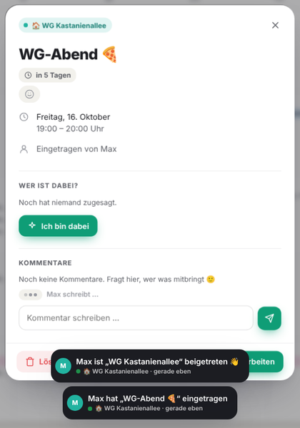
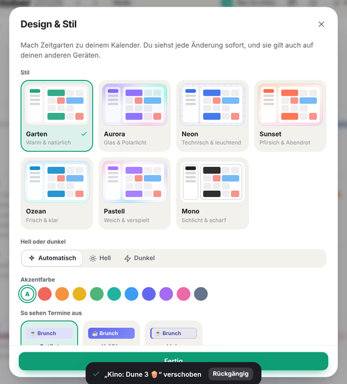

# 🌿 Zeitgarten

**Der gemeinsame Kalender – wie TimeTree, nur schöner.**
Lade Freunde und Familie per Link ein, plant live zusammen, hol deine bestehenden Kalender mit einem Klick dazu und gib Zeitgarten deinen eigenen Look.




## Was die App kann

### Zusammen planen – live
- **Freunde per Link einladen**: Link kopieren, über WhatsApp oder das Teilen-Menü schicken. Wer ihn öffnet, gibt nur seinen Namen ein und ist dabei, ohne Passwort und ohne E-Mail
- **Gemeinsame Kalender** für Familie, WG, Verein, Team – jeder mit eigener Farbe und Emoji
- **Alles live**: Neue Termine, Zusagen und Kommentare der anderen erscheinen sofort
- **Wer ist online?** Grüner Punkt an allen, die Zeitgarten gerade offen haben
- **„Max schreibt …“** – du siehst, wenn jemand gerade einen Kommentar tippt
- **Reaktionen** ❤️ 👍 🎉 😂 auf Termine, mit kleinem Emoji-Feuerwerk
- **„Ich bin dabei“** mit Konfetti, und **Kommentare** („Wer bringt was mit?“)
- **Neuigkeiten** 🔔: Glocke mit Zähler, Live-Meldungen und auf Wunsch Browser-Benachrichtigungen

### Schön & persönlich
- **7 Designs** zum Umschalten – jeweils hell und dunkel: Garten, Aurora (Glas & Polarlicht), Neon, Sunset, Ozean, Pastell, Mono
- **Selbst einstellen**: Akzentfarbe, Termin-Stil (getönt, kräftig, Linie), Schrift für Überschriften (modern, rund, elegant, technisch), Ecken (eckig bis extra rund), Abstände, Kalenderwochen, bewegter Hintergrund, Effekte
- Dein Design wird **auf allen deinen Geräten** übernommen



### Übersicht „Heute“
- Himmel, der sich mit der **Tageszeit** ändert (Sonnenaufgang, Tag, Abendrot, Sternenhimmel)
- **Countdown** bis zum nächsten Termin, bei laufenden Terminen mit Fortschrittsbalken
- **Tagesablauf** mit „Jetzt“-Linie, **Wochen-Grafik** (verplante Stunden) und **Heatmap** der nächsten 5 Wochen
- **Vorfreude**: Wie viele Tage noch bis zum Urlaub, zur Hochzeit, …

### Kalender
- **Monat, Woche, Liste** mit Suche – plus Mini-Kalender
- **Ziehen & Ablegen**: Termine in der Monatsansicht einfach auf einen anderen Tag ziehen (am Handy: lange drücken), mit „Rückgängig“
- **Wiederholungen**: täglich, werktags, wöchentlich, alle 2 Wochen, monatlich, jährlich – auf Wunsch mit Enddatum
- **Kalender importieren**
  - als **.ics-Datei** (Export aus Google Kalender, Apple Kalender oder Outlook)
  - als **Internet-Link** (z. B. die „Privatadresse im iCal-Format“ von Google oder ein öffentlicher iCloud-Kalender). Ein Link-Import ist ein **Abo** und aktualisiert sich alle 6 Stunden von selbst.
  - Feiertage für Deutschland und Österreich mit einem Klick
- **Export**: Jeder Kalender hat einen Abo-Link, mit dem du ihn auch in Apple, Google oder Outlook siehst
- **Fürs Handy gemacht**: Tab-Leiste unten, Wischen zum Blättern, lässt sich wie eine App auf den Home-Bildschirm legen
- **Mehrere Geräte**: Mit deinem persönlichen Anmelde-Link nutzt du dein Profil auch auf Laptop und Tablet


<p align="center">
  
  
</p>

### Tastenkürzel (am Computer)

| Taste | Aktion |
| --- | --- |
| `←` / `→` | Zurück / weiter blättern |
| `T` | Heute |
| `N` | Neuer Termin |
| `H` `M` `W` `L` | Übersicht, Monat, Woche, Liste |
| `D` | Design & Stil |

## Starten auf deinem Computer

Du brauchst nur [Node.js](https://nodejs.org) (Version 20 oder neuer). Andere Pakete musst du nicht installieren.

```bash
npm start
```

Dann im Browser **http://localhost:3000** öffnen. Fertig.

> Tipp: Mit `npm run dev` startet der Server bei jeder Änderung am Code automatisch neu.

## Demo ohne Server

Zum Ausprobieren gibt es eine Demo-Version, die komplett im Browser läuft. Sie nutzt dieselbe Logik wie der Server (`server/core.js`), speichert aber alles nur auf dem eigenen Gerät. Zwei Beispiel-Freunde, Max und Lena, machen live mit: Sie kommen online, tragen Termine ein, antworten auf Kommentare und reagieren auf neue Termine.

```bash
npm run demo
```

Das baut die Demo nach `demo/dist/`. Den Ordner kannst du auf jeden statischen Hoster legen, zum Beispiel GitHub Pages. Einladungslinks und Kalender-Abos per Link funktionieren in der Demo nicht, dafür braucht es den echten Server.

## Mit Freunden nutzen (online stellen)

Damit deine Freunde den Einladungslink öffnen können, muss die App im Internet erreichbar sein. Dafür gibt es mehrere Wege:

| Weg | Gut für | So geht’s |
| --- | --- | --- |
| **Schneller Test-Tunnel** | Einen Abend lang ausprobieren | App starten und dann [`cloudflared tunnel --url http://localhost:3000`](https://developers.cloudflare.com/cloudflare-one/connections/connect-networks/do-more-with-tunnels/trycloudflare/) ausführen. Du bekommst eine `https://…trycloudflare.com`-Adresse, die du teilen kannst. Sie funktioniert nur, solange dein Computer läuft. |
| **Hosting mit Docker** (z. B. Railway, Fly.io, Render) | Dauerhaft | Das Projekt enthält ein `Dockerfile`. **Wichtig:** Lege beim Anbieter ein dauerhaftes Volume an und hänge es unter `/data` ein. Sonst sind die Kalender nach jedem Neustart weg. |
| **Eigener Server oder Raspberry Pi** | Dauerhaft, volle Kontrolle | `npm start` laufen lassen und für HTTPS z. B. [Caddy](https://caddyserver.com) davorschalten. |

Einstellungen über Umgebungsvariablen:

| Variable | Bedeutung | Standard |
| --- | --- | --- |
| `PORT` | Port des Servers | `3000` |
| `DATA_DIR` | Ordner, in dem die Daten gespeichert werden | `./data` |

## Deine Daten

Alles wird in **einer Datei** gespeichert: `data/zeitgarten.json`. Zum Sichern kopierst du einfach diese Datei.
Die App benutzt keine Tracker, keine Werbung und lädt keine fremden Schriften oder Skripte.

## Tests

```bash
npm test
```

Die Tests prüfen den Kalender-Import (Google, Apple, Outlook), den Export, die Zeitzonen (auch bei der Zeitumstellung), die Wiederholungsregeln und die API mit Einladungen, Neuigkeiten, Reaktionen, Online-Status und Design-Einstellungen.

## So ist das Projekt aufgebaut

```
server/
  index.js        Webserver: HTTP, Live-Verbindungen, Dateien
  core.js         Die eigentliche Logik (Kalender, Einladungen, Termine, Neuigkeiten …), auch für die Demo
  ics.js          .ics-Dateien lesen und schreiben
  safe-fetch.js   Kalender-Links sicher aus dem Internet laden
  store.js        Speichern in einer JSON-Datei
public/
  index.html      Einstieg der App
  css/app.css     Das ganze Design: 7 Stile, hell und dunkel, alle Einstellungen
  js/app.js       Start, Seitenleiste, Navigation, Live-Updates
  js/dashboard.js Übersicht „Heute“ mit Himmel, Countdown und Grafiken
  js/views.js     Monats-, Wochen- und Listenansicht, Ziehen & Ablegen
  js/sheets.js    Fenster: Termin, Editor, Kalender, Import, Profil, Neuigkeiten, Design
  js/themes.js    Designs und persönliche Einstellungen
  js/fx.js        Konfetti, Emoji-Regen und Tooltips
  js/recur.js     Wiederkehrende Termine
  js/time.js      Datum, Zeitzonen und Kalenderwochen
demo/
  api.js          Ersetzt in der Demo den Server: alles im Browser, mit Max und Lena als Beispiel-Freunden
  build.mjs       Baut die Demo nach demo/dist/
test/             Automatische Tests
```

Es gibt keine Abhängigkeiten und keinen Build-Schritt. Was im Ordner steht, läuft so.

## Über dieses Repo

Dieses Repository war mein Einstieg in die Welt von Git und GitHub. Git ist ein Versionskontrollsystem, das Änderungen an Dateien nachverfolgt.

1. Repository klonen
2. Änderungen vornehmen
3. Commit erstellen
4. Pull Request öffnen
