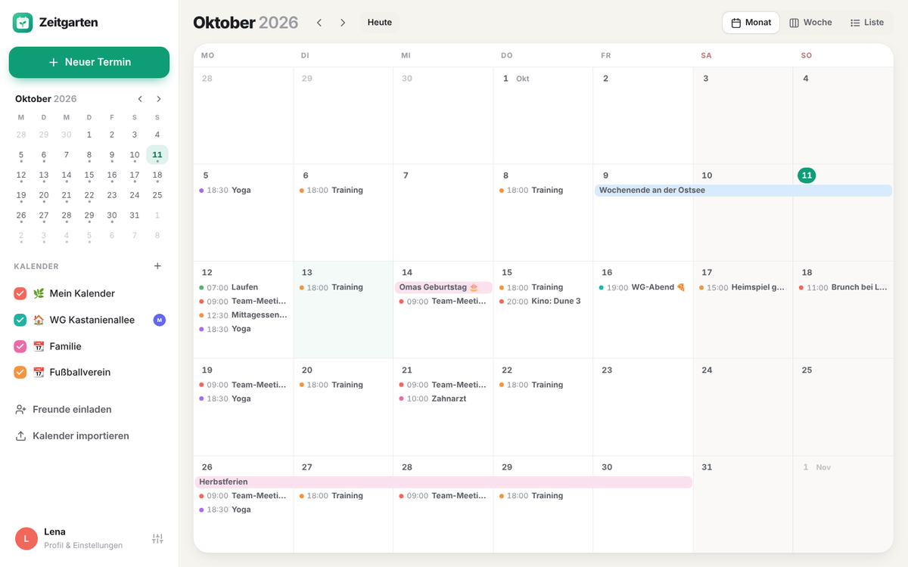
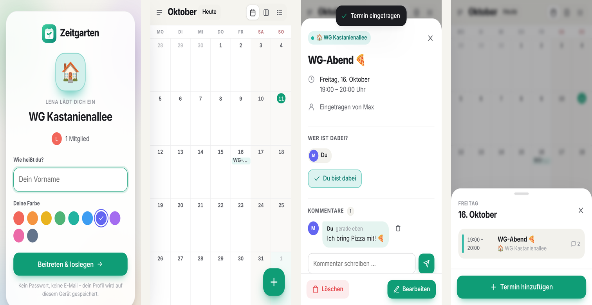
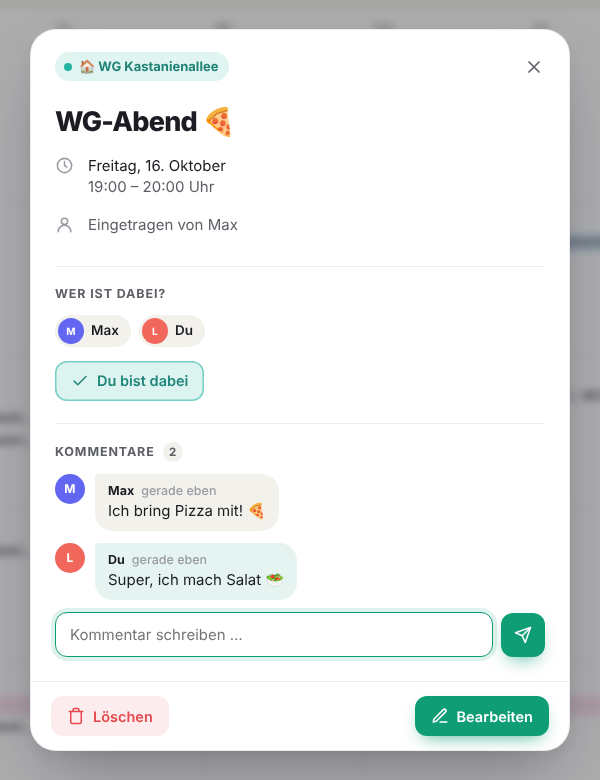

# 🌿 Zeitgarten

**Der gemeinsame Kalender – wie TimeTree, nur schöner.**
Lade Freunde und Familie per Link ein, plant zusammen und hol deine bestehenden Kalender mit einem Klick dazu.





## Was die App kann

- **Gemeinsame Kalender** für Familie, WG, Verein, Team – jeder mit eigener Farbe und Emoji
- **Freunde per Link einladen**: Link kopieren, über WhatsApp oder das Teilen-Menü schicken. Wer den Link öffnet, gibt nur seinen Namen ein und ist dabei – ohne Passwort und ohne E-Mail
- **Zusammen planen**: Bei jedem Termin kann man auf „Ich bin dabei“ tippen und Kommentare schreiben („Wer bringt was mit?“)
- **Live**: Wenn jemand etwas einträgt, siehst du es sofort, ohne die Seite neu zu laden
- **Drei Ansichten**: Monat, Woche (mit Stundenraster) und Liste mit Suche
- **Wiederholungen**: täglich, werktags, wöchentlich, alle 2 Wochen, monatlich, jährlich – auf Wunsch mit Enddatum
- **Kalender importieren**
  - als **.ics-Datei** (Export aus Google Kalender, Apple Kalender oder Outlook)
  - als **Internet-Link** (z. B. die „Privatadresse im iCal-Format“ von Google oder ein öffentlicher iCloud-Kalender). Ein Link-Import ist ein **Abo** und aktualisiert sich alle 6 Stunden von selbst.
  - Feiertage für Deutschland und Österreich mit einem Klick
- **Export**: Jeder Kalender hat einen Abo-Link, mit dem du ihn auch in Apple, Google oder Outlook siehst
- **Fürs Handy gemacht**: Lässt sich wie eine App auf den Home-Bildschirm legen, Wischen zum Blättern, Dunkelmodus
- **Mehrere Geräte**: Mit deinem persönlichen Anmelde-Link nutzt du dein Profil auch auf Laptop und Tablet

<p align="center"></p>

## Starten auf deinem Computer

Du brauchst nur [Node.js](https://nodejs.org) (Version 20 oder neuer). Andere Pakete musst du nicht installieren.

```bash
npm start
```

Dann im Browser **http://localhost:3000** öffnen. Fertig.

> Tipp: Mit `npm run dev` startet der Server bei jeder Änderung am Code automatisch neu.

## Mit Freunden nutzen (online stellen)

Damit deine Freunde den Einladungslink öffnen können, muss die App im Internet erreichbar sein. Dafür gibt es mehrere Wege:

| Weg | Gut für | So geht’s |
| --- | --- | --- |
| **Schneller Test-Tunnel** | Einen Abend lang ausprobieren | App starten und dann [`cloudflared tunnel --url http://localhost:3000`](https://developers.cloudflare.com/cloudflare-one/connections/connect-networks/do-more-with-tunnels/trycloudflare/) ausführen. Du bekommst eine `https://…trycloudflare.com`-Adresse, die du teilen kannst. Sie funktioniert nur, solange dein Computer läuft. |
| **Hosting mit Docker** (z. B. Railway, Fly.io, Render) | Dauerhaft | Das Projekt enthält ein `Dockerfile`. **Wichtig:** Lege beim Anbieter ein dauerhaftes Volume an und hänge es unter `/data` ein. Sonst sind die Kalender nach jedem Neustart weg. |
| **Eigener Server oder Raspberry Pi** | Dauerhaft, volle Kontrolle | `npm start` laufen lassen und für HTTPS z. B. [Caddy](https://caddyserver.com) davorschalten. |

Einstellungen über Umgebungsvariablen:

| Variable | Bedeutung | Standard |
| --- | --- | --- |
| `PORT` | Port des Servers | `3000` |
| `DATA_DIR` | Ordner, in dem die Daten gespeichert werden | `./data` |

## Deine Daten

Alles wird in **einer Datei** gespeichert: `data/zeitgarten.json`. Zum Sichern kopierst du einfach diese Datei.
Die App benutzt keine Tracker, keine Werbung und lädt keine fremden Schriften oder Skripte.

## Tests

```bash
npm test
```

Die Tests prüfen den Kalender-Import (Google, Apple, Outlook), den Export, die Zeitzonen (auch bei der Zeitumstellung) und die Wiederholungsregeln.

## So ist das Projekt aufgebaut

```
server/
  index.js        Webserver und API (Kalender, Einladungen, Termine, Kommentare, Live-Updates)
  ics.js          .ics-Dateien lesen und schreiben
  safe-fetch.js   Kalender-Links sicher aus dem Internet laden
  store.js        Speichern in einer JSON-Datei
public/
  index.html      Einstieg der App
  css/app.css     Das ganze Design (hell und dunkel)
  js/app.js       Start, Seitenleiste, Navigation, Live-Updates
  js/views.js     Monats-, Wochen- und Listenansicht
  js/sheets.js    Fenster: Termin, Editor, Kalender-Einstellungen, Import, Profil
  js/recur.js     Wiederkehrende Termine
  js/time.js      Datum und Zeitzonen
test/             Automatische Tests
```

Es gibt keine Abhängigkeiten und keinen Build-Schritt. Was im Ordner steht, läuft so.

## Über dieses Repo

Dieses Repository war mein Einstieg in die Welt von Git und GitHub. Git ist ein Versionskontrollsystem, das Änderungen an Dateien nachverfolgt.

1. Repository klonen
2. Änderungen vornehmen
3. Commit erstellen
4. Pull Request öffnen
